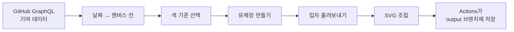

# Commit Canvas

GitHub 기여 1년치를 한 장의 그림으로 그려주는 프로필 위젯.
커밋한 날마다 입자가 흘러나오고, 쓴 언어와 프로젝트가 색이 됩니다.

<picture>
  <source media="(prefers-color-scheme: dark)" srcset="docs/demo-dark.svg">
  
</picture>

<sub>예시 그림 · 1년 동안 Go → TypeScript → Python → Rust로 주력 언어가 바뀐 가상의 개발자</sub>

[공유 페이지](https://hhhv-v.github.io/commit-canvas/) · [Fork](https://github.com/HHHv-v/commit-canvas/fork) · [동작 방식](#동작-방식)

## 시작하기

1. 이 레포를 Fork 해요.
2. Fork한 레포의 **Actions** 탭에서 워크플로를 켜고, `Generate Commit Canvas` → **Run workflow**를 눌러요.
3. 프로필 README에 아래를 붙여요. `USER`를 내 아이디로 바꾸면 돼요.

```html
<a href="https://github.com/HHHv-v/commit-canvas#readme">
  <picture>
    <source media="(prefers-color-scheme: dark)" srcset="https://raw.githubusercontent.com/USER/commit-canvas/output/commit-canvas-dark.svg">
    
  </picture>
</a>
```

매일 자정(KST)에 새 기여가 반영되고, 그림을 누르면 Commit Canvas 소개 페이지(이 README)로 이어져서, 보는 사람도 바로 자기 그림을 만들 수 있어요.

## 그림 규칙

| 데이터 | 그림 |
|---|---|
| 시간 | 왼쪽 → 오른쪽으로 흐름. 첫 기여 이전의 빈 기간은 잘라냄 |
| 기여한 날 | 그날 칸에서 출발하는 입자들. 기여가 많을수록 입자 수·길이·굵기가 늘어남 |
| 흐름 | curl noise + 도메인 워핑으로 만든 유체장. 깃허브 아이디가 시드라 사람마다 다름 |
| 색 기준 | 언어·레포·기여량 중 데이터에 맞춰 자동 선택 (아래 참고) |
| 색감 | 팔레트 8종 중 아이디로 하나를 고름. 입자마다 색조를 살짝 비틀어 한 색 안에서도 변화가 있음 |

### 색 기준 자동 선택 (`--color auto`)

한 가지 언어만 쓰는 사람도 그림이 단색이 되지 않도록, 색의 기준을 데이터에 맞춰 골라요.

| 상황 | 색 기준 |
|---|---|
| 여러 언어를 고르게 씀 | **언어별** (`Languages`) |
| 한 언어가 80% 이상 | **레포별** (`Projects`) |
| 레포도 하나뿐 | **그날 기여량별** (`Daily`: 1–2 / 3–5 / 6–9 / 10+) |

직접 고르고 싶다면 `--color language | repo | intensity`를 쓰면 돼요.

### 팔레트 (`--palette`)

`aurora` `sunset` `ocean` `neon` `pastel` `forest` `candy` `ember` 8종이 있어요.

| 값 | 동작 |
|---|---|
| `auto` (기본) | 아이디로 하나를 고정 선택. 사람마다 색감이 다르고, 같은 사람은 매일 같은 색감 |
| `random` | 그림을 새로 그릴 때마다 팔레트가 바뀜 |
| 팔레트 이름 | 원하는 팔레트로 고정 |

같은 팔레트 안에서도 입자마다 색조를 ±14° 정도 비틀어서, 한 언어만 쓰는 사람도 그림이 평평한 단색으로 보이지 않아요.

## 동작 방식

그림 한 장은 아래 6단계를 거쳐 만들어져요. 코드는 모두 [`src/generate.py`](src/generate.py) 한 파일에 있어요.



### 1. 기여 데이터 가져오기

GitHub GraphQL API에서 두 가지를 가져와요.

| 데이터 | 쓰임 |
|---|---|
| `contributionCalendar` | 날짜별 기여 수. 입자의 개수·길이·굵기를 정함 |
| `commitContributionsByRepository` | 레포별 커밋 기록과 레포의 주 언어. 그날의 색을 정함 |

하루에 여러 레포에 커밋했다면 커밋이 가장 많은 레포(또는 언어)가 그날의 대표가 돼요.

### 2. 날짜를 캔버스 위치로 바꾸기

달력처럼 **주(week)는 가로, 요일은 세로**로 배치해요. 그날의 칸 중심에 약간의 무작위 흔들림을 더해서, 격자 느낌이 나지 않게 해요.
첫 기여가 나오기 전의 빈 주는 잘라내서, 최근에 시작한 사람도 캔버스가 꽉 차게 그려져요. (최소 16주는 유지)

### 3. 색 기준 고르기

언어 비율을 먼저 보고, 한 언어가 80% 이상이면 레포 기준으로, 레포도 하나뿐이면 기여량 기준으로 넘어가요.
그다음 **많이 쓴 순서대로** 팔레트 색을 배정해요. GitHub 공식 언어 색은 TypeScript와 Python처럼 서로 비슷한 경우가 있어서, 서로 확실히 구분되는 자체 팔레트를 써요.
각 색은 색조를 0°, +14°, −14° 비튼 세 가지 그라데이션으로 만들어지고, 입자마다 셋 중 하나를 무작위로 골라요.

### 4. 유체장 만들기

캔버스의 모든 위치에 "여기서는 이 방향으로 흘러라"라는 방향을 정해두는 단계예요.

| 단계 | 하는 일 |
|---|---|
| Perlin noise | 위치마다 부드럽게 변하는 값을 만듦. 가까운 위치끼리는 값도 비슷함 |
| 도메인 워핑 | 노이즈 값으로 좌표 자체를 한 번 더 비틀어서, 마블링 같은 소용돌이 모양을 만듦 |
| curl | 노이즈 값의 기울기를 구한 뒤 90도 돌려 흐름 방향으로 씀. 입자가 한 점으로 빨려 들지 않는 유체 흐름이 됨 |
| 오른쪽 바람 | 모든 방향에 오른쪽 성분을 조금 더함. 그림 전체가 시간 방향으로 흐름 |
| 시드 | 깃허브 아이디의 SHA-256 해시로 노이즈를 섞음. 아이디마다 다른 유체장, 같은 아이디는 매일 같은 유체장 |

```python
def angle(x, y):
    vx =  d(potential)/dy        # curl: 퍼텐셜의 기울기를 90도 회전
    vy = -d(potential)/dx
    return atan2(vy, vx + 0.55)  # 오른쪽으로 흐르는 바람 추가
```

### 5. 입자 흘려보내기

기여한 날마다 그 칸 주변에 입자를 뿌리고, 각 입자를 유체장을 따라 한 걸음(5px)씩 움직이며 궤적을 기록해요.

| 기여량이 많을수록 | 결과 |
|---|---|
| 입자 수 증가 (하루 최대 36개) | 색이 더 진하게 겹침 |
| 이동 거리 증가 | 더 멀리 흐르며 큰 곡선을 그림 |
| 굵은 입자 비율 증가 | 붓질이 두껍게 보임 |

입자 하나하나는 얇고 반투명해서, 수천 개가 겹치는 곳에서 색이 섞이며 물감처럼 보여요.
전체 입자 수는 약 2,200개로 제한해서, 기여가 아주 많은 사람도 파일이 너무 무거워지지 않아요.

### 6. SVG 조립

| 요소 | 하는 일 |
|---|---|
| 상대 좌표 경로 | 점마다 절대 위치 대신 이동량(`5 -1`)만 적어서 용량을 줄임 |
| 그룹·클래스 | 같은 날 입자의 색·시작 시간은 그룹에 한 번만, 굵기·투명도는 CSS 클래스로 재사용 |
| 마스크 | 위아래·좌우 가장자리와 제목 뒤쪽에서 입자가 부드럽게 사라짐 |
| 애니메이션 | `stroke-dashoffset`으로 입자가 그려지는 효과. 오래된 주부터 차례로 흘러나옴. `prefers-reduced-motion` 설정 시 정지 |
| 테마 | 라이트·다크 두 벌 생성. 다크에서는 블러를 겹쳐 빛 번짐 추가 |

README 이미지 안에서는 JavaScript가 실행되지 않기 때문에, 움직임은 모두 SVG 안의 CSS 애니메이션으로만 만들어요.

### 7. 자동 갱신

GitHub Actions가 매일 자정(KST)과 main에 push할 때마다 위 과정을 실행하고, 결과 SVG를 `output` 브랜치에 덮어써요.
이미지 주소가 항상 같아서, 프로필 README에 한 번만 붙여두면 커밋할수록 그림이 저절로 자라나요.

## 공유하기

[공유 페이지](https://hhhv-v.github.io/commit-canvas/)에 아이디를 넣으면 내 그림을 크게 보고 공유할 수 있어요. 링크는 `?user=아이디` 형태라 그대로 보내면 돼요.

| 기능 | 설명 |
|---|---|
| PNG 저장 | 애니메이션이 끝난 완성 상태를 2배 해상도(2400×1120)로 저장 |
| 공유하기 | 모바일에서는 시스템 공유 시트로 이미지와 링크를 함께 보냄. 지원하지 않는 브라우저는 링크 복사 |
| X · LinkedIn | 문구와 링크가 채워진 게시 화면을 엶 |
| 링크 복사 | 내 그림 공유 페이지 주소를 복사 |
| README 코드 복사 | 그림을 누르면 Commit Canvas README로 이어지는 프로필 코드를 복사 |
| 테마 전환 | 다크·라이트 그림을 바꿔 봄 |

공유 페이지는 서버 없이 동작해요. 각자의 `output` 브랜치에 있는 SVG를 브라우저가 직접 불러오고, PNG 변환도 브라우저 안에서 해요.

## 로컬에서 돌려보기

```bash
python src/generate.py --user HHHv-v --demo --out dist/demo.svg            # 샘플 (여러 언어)
python src/generate.py --user HHHv-v --demo single --out dist/demo.svg     # 샘플 (한 언어, 여러 레포)
python src/generate.py --user commit-canvas --demo showcase --palette candy  # README 예시 그림
GITHUB_TOKEN=... python src/generate.py --user HHHv-v                      # 실제 데이터
```

| 옵션 | 값 | 기본값 |
|---|---|---|
| `--theme` | `dark` / `light` | `dark` |
| `--style` | `fluid` (입자 흐름) / `petal` (붓터치) | `fluid` |
| `--color` | `auto` / `language` / `repo` / `intensity` | `auto` |
| `--palette` | `auto` / `random` / 팔레트 이름 | `auto` |
| `--demo` | `multi` / `single` / `mono` / `showcase` (샘플 데이터 종류) | 실제 데이터 |

의존성 없이 Python 표준 라이브러리만 사용해요.

## 로드맵

- [x] 입자 유체 스타일 (`--style fluid`, 기본) / 붓터치 스타일 (`--style petal`)
- [x] 한 언어 사용자를 위한 색 기준 자동 선택
- [x] 팔레트 8종과 입자별 색조 변주
- [x] 공유 페이지 (PNG 저장, X·LinkedIn 공유, 링크 복사)
- [ ] Vercel API 버전 (`/api?user=...`) — Fork 없이 바로 사용
- [ ] 테마 추가 (수묵, 수채, 네온)

## License

MIT
